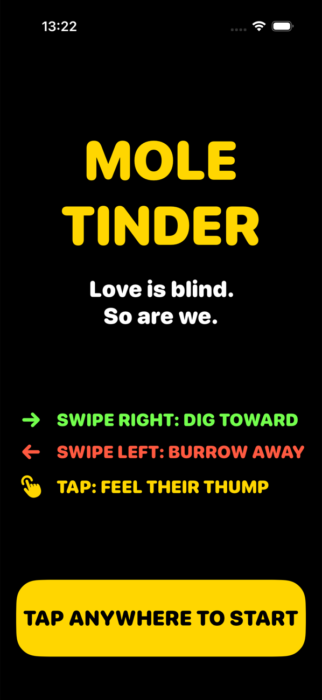
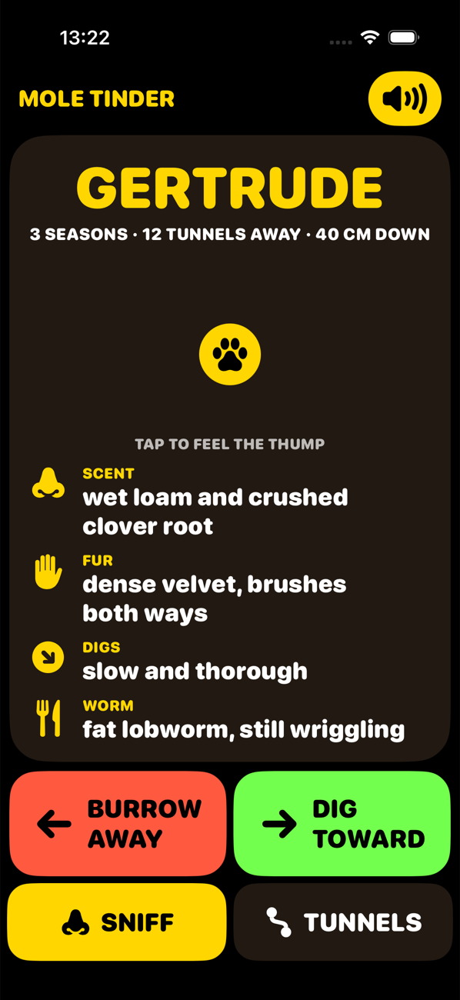
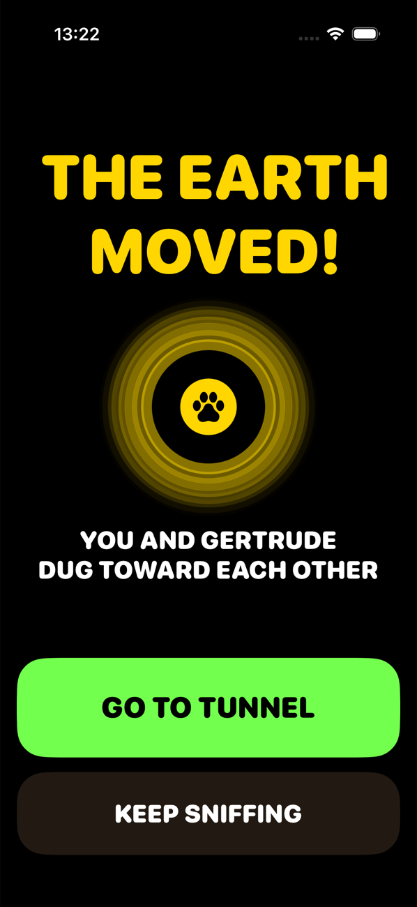
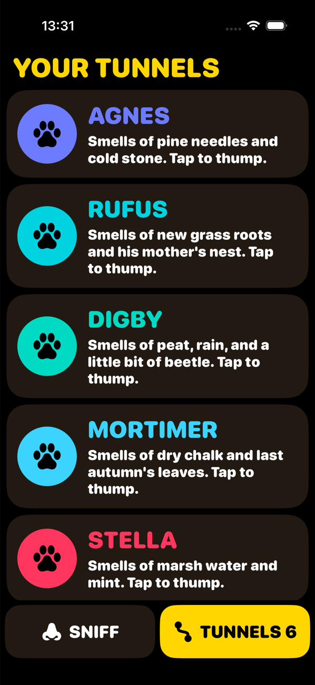
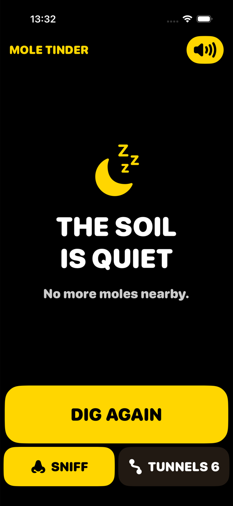

# Mole Tinder

A one-prompt benchmark for coding models: build a dating app for moles as a
native iOS app, without help.

The task is small enough to finish in one go and open enough to show judgment.
The prompt says who the users are (nearly blind, living underground) and tells
the model to design for them, not for humans. What a model does with that
sentence is most of what gets rated.

- [PROMPT.md](PROMPT.md): the prompt, verbatim
- [PROTOCOL.md](PROTOCOL.md): how to run, record and rate
- [templates/run.md](templates/run.md): empty run record

## Results

| Model | Run | Reasoning | Time | Builds first try | Checks | Rating |
|---|---|---|---|---|---|---|
| Claude Fable 5.2 | [2026-11-11-01](runs/claude-fable-5-2/2026-11-11-01/run.md) | medium | ~5–6 min | Yes | 9 of 10, 1 partly | not yet rated |

## Screenshots

### Claude Fable 5.2, 2026-11-11-01

<p>
  
  
  
  
  
</p>

Demo with sound: [showcase.mp4](runs/claude-fable-5-2/2026-11-11-01/demo/showcase.mp4)

## Layout

```
PROMPT.md
PROTOCOL.md
templates/run.md
runs/<model-id>/<yyyy-mm-dd>-<nn>/
    run.md          facts, checks, rating
    app/            the project exactly as delivered
    demo/           showcase.mp4
    screenshots/
```

A second run of the same model, or the same model at another reasoning level,
is another dated folder under the same model id.
